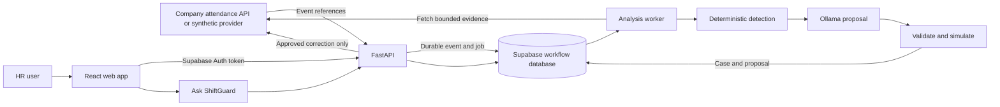

# ShiftGuard

[](https://github.com/DayForce-AIIC/Time-Attandance-Agent/actions/workflows/ci.yml)

**Evidence-led timecard exception review.** Deterministic rules detect attendance issues, an LLM proposes bounded corrections, and an authorized HR user makes the decision.

ShiftGuard is a university innovation challenge prototype. It uses synthetic attendance data by default and does not calculate payroll. A real company integration, production credentials, deployment host, and operational policies must be supplied by the organization before production use.

## Product problem

HR and timekeeping teams often have to compare punches, schedules, local attendance rules, and source-system history by hand when a timecard looks wrong. That review takes time, and an automatic correction can create payroll or compliance risk if it misses context. ShiftGuard is intended to reduce the manual work of finding and investigating exceptions while keeping the correction decision with an authorized person.

ShiftGuard is a review and workflow aid. The company's attendance or HR system remains the source of truth, and ShiftGuard does not calculate payroll or autonomously change a timecard.

## User journey

1. An attendance change is received from the source system. In the authenticated workflow, ShiftGuard verifies the signed event, deduplicates it, and queues analysis. The local demo starts with seeded synthetic cases instead.
2. The analysis worker fetches the bounded attendance evidence needed for the case and runs deterministic rules to identify possible exceptions.
3. When a rule finds an exception, the configured model can draft a correction with references to the relevant policy. Deterministic validation checks the proposal and simulates its effect. If generation or validation fails, the case is escalated for human review.
4. An HR reviewer checks the punches, schedule, policy evidence, validation results, and proposal, then approves, edits, or rejects it.
5. An approval or valid edit is checked again against current data before a correction is sent to the attendance provider. A rejection sends no correction. The outcome and audit history remain available for review.

Ask ShiftGuard is a separate read-only experience for questions about authorized cases and policy evidence; it cannot approve or change attendance.

## What it does

- Detects timecard exceptions using deterministic attendance rules.
- Generates evidence-grounded correction proposals and validates them against policy and simulated timecard effects.
- Routes proposals to a human for approve, edit, or reject decisions.
- Records proposals, decisions, validations, and audit events.
- Provides a read-only Ask ShiftGuard assistant. It requires a reachable Ollama model; it is unavailable in mock LLM mode.
- Supports a Supabase-backed HR workflow with sign-in, persisted cases and decisions, a durable analysis worker, writeback status, and per-user assistant conversations.
- Provides an HR-only Policies page to edit built-in rules and manage company guidance used by analysis and Ask ShiftGuard.
- Integrates with a synthetic attendance provider for demos and a vendor-neutral HTTP provider interface for company integration work.

### Data ownership

The company HR/timekeeping platform remains the source of truth for employees, punches, schedules, and leave. ShiftGuard does not create a master employee or attendance database. In Supabase mode it stores workflow data such as event references, exception cases, proposals, validations, decisions, audit events, assistant conversations, and organization policies with revisions. The connector fetches attendance evidence when needed and retains a minimized case snapshot and source hash for review.

The Policies page is available to signed-in HR users in Supabase mode. It can enable or disable built-in rules and edit their titles, descriptions, and severity. Company guidance can be added, edited, restored, or archived; it is supplied to the LLM as reference context and does not add detector logic. Built-in numeric thresholds and algorithms remain fixed in this prototype. Each proposal keeps a snapshot of the policy text and revisions used for review.

The bundled company provider is synthetic. The real company API contract, webhook signature format, credentials, field mappings, and correction behavior must be agreed and verified with that company. See [the company integration contract](docs/COMPANY_INTEGRATION_CONTRACT.md).

## Architecture and key technical decisions



The diagram shows the authenticated Supabase workflow. The first-run local demo uses seeded synthetic records in SQLite, the mock attendance provider, and a mock proposal generator. It does not require Supabase or Ollama.

The main technical decisions are:

- **Rules detect; the model proposes.** Deterministic code identifies timekeeping exceptions. An LLM is used only to draft a bounded, policy-grounded suggestion; strict schema and policy checks plus a timecard simulation validate it.
- **A person controls corrections.** Proposal generation never writes to the attendance system. The API revalidates an HR approval or edit before writeback; rejection does not write a correction.
- **Events are processed asynchronously.** The signed event endpoint stores an idempotent event and durable job in Supabase, then returns. A separate worker fetches source evidence, analyzes it, and records the result with retry and failure handling.
- **The source system owns attendance data.** ShiftGuard stores workflow records and minimized evidence needed to review cases. The audit trail records prompt and model-output hashes rather than their full text; retention and deletion policy still require company approval.
- **Providers separate the prototype from a company connector.** Synthetic providers support development. A generic HTTP adapter defines an integration boundary, but the real company's API mapping, credentials, and correction contract still need to be agreed and tested.
- **The storage boundary is not production-ready yet.** Supabase mode provides authentication and PostgreSQL workflow storage, but the application still initializes and uses SQLite for core API resources. The production configuration gate therefore refuses startup until those resources are migrated to shared PostgreSQL.

For component responsibilities and validation details, see [the architecture notes](docs/ARCHITECTURE.md). The [company integration contract](docs/COMPANY_INTEGRATION_CONTRACT.md) describes the API shape that must be confirmed with the real vendor.

## Requirements

For the local synthetic demo:

- macOS, Linux, or another Unix-like environment with `make`
- Python 3.11 (the backend CI and OpenAPI contract generation runtime)
- Node.js 20 or newer and npm
- Git

For the complete authenticated HR workflow, also install the [Supabase CLI](https://supabase.com/docs/guides/cli) and create a Supabase project. For AI-generated proposals and Ask ShiftGuard, install [Ollama](https://ollama.com/download) and download a model. Docker is optional and only needed for the container workflow.

## Run the local demo (recommended first run)

These steps run the UI and API with a local SQLite database, synthetic attendance fixtures, and the mock LLM. No Supabase project or model download is needed for this first run.

### 1. Install dependencies and local configuration

On a fresh checkout, from the repository root:

```bash
cp .env.example .env
cp frontend/.env.example frontend/.env.local
make setup
```

The commands above create local configuration files. If you already have a `.env` or `frontend/.env.local`, skip the matching copy command so your values are preserved. The defaults select `AUTH_MODE=demo`, `ATTENDANCE_PROVIDER=mock`, and `LLM_PROVIDER=mock`.

The API creates and seeds the local SQLite database on first startup. It is stored at `backend/shiftguard.db` by default. To initialize or detect cases manually, run `make seed`; it preserves existing demo data.

### 2. Start the API and web app

Open two terminals at the repository root.

**Terminal 1 — API:**

```bash
make backend
```

**Terminal 2 — frontend:**

```bash
make frontend
```

Open [http://localhost:5173](http://localhost:5173). The API health endpoint is [http://localhost:8000/api/v1/health](http://localhost:8000/api/v1/health), and interactive API documentation is at [http://localhost:8000/docs](http://localhost:8000/docs).

### 3. Try the review flow

1. Open the exception queue and select a case.
2. Click **Generate AI proposal** and wait for the validated suggestion.
3. Review the punches, schedule, policy passages, and proposed correction.
4. Approve, edit, or reject the proposal. An approved correction is simulated and checked again before it is applied to the demo provider.
5. Open the audit history and metrics to inspect the recorded outcome.
6. Use the demo fault controls to try `bad_then_good`, `always_bad`, `garbage`, `timeout`, `bad_citation`, and `naive_latest`. These show retry, validation, and escalation behavior.
7. Use **Reset demo data** to clear and recreate the local demo state.

The local demo uses mock proposal responses, not a live model. Ask ShiftGuard remains unavailable while `LLM_PROVIDER=mock`.

## Enable a local Ollama model

For a Mac M4 demo, a smaller option is `qwen2.5:3b-instruct`. Ollama lists this quantized model at about 1.9 GB and identifies its license as the Qwen Research License. Review the [model page](https://ollama.com/library/qwen2.5%3A3b-instruct) and its license terms before distributing it.

1. Install and start Ollama. The Ollama app can run it in the background; alternatively use `ollama serve`.
2. Download the model:

   ```bash
   ollama pull qwen2.5:3b-instruct
   ```

3. Update the root `.env`:

   ```dotenv
   LLM_PROVIDER=ollama
   OLLAMA_URL=http://localhost:11434
   OLLAMA_MODEL=qwen2.5:3b-instruct
   ```

4. Restart `make backend`. The local SQLite demo now uses Ollama for proposals, and Ask ShiftGuard is available when the model is reachable.

The API and, in Supabase mode, the worker must be able to reach the configured Ollama URL. For Docker or remote Ollama, `localhost` refers to the container or server itself; set `OLLAMA_URL` to an address reachable from both services.

## Run the authenticated Supabase HR workflow

This path adds HR sign-in, persistent workflow records, event intake, automated background analysis, and persisted assistant conversations. It still uses synthetic attendance data until a company sandbox integration is configured.

### 1. Create and link a Supabase project

Create a Supabase project and install the CLI. From the repository root:

```bash
supabase login
supabase link --project-ref YOUR_PROJECT_REF
supabase db push --dry-run --remote
make supabase-db-push
```

Apply every migration in `supabase/migrations`. They create workflow tables, user profiles and scope, durable analysis jobs, writeback state, conversation ordering, worker heartbeats, and organization policies with revision history. Review the dry run before applying schema changes.

### 2. Create the HR user, organization, and integration

In the Supabase Dashboard, create or invite a test HR user under **Authentication → Users**. Public self-registration is not part of this prototype.

In **SQL Editor**, create an organization and copy the returned UUID:

```sql
insert into public.organizations (name)
values ('Example Company')
returning id;
```

Create a profile for the Auth user's UUID and the organization UUID:

```sql
insert into public.user_profiles (user_id, organization_id, role)
values ('<auth-user-uuid>', '<organization-uuid>', 'HR');
```

Create an active integration and copy its returned UUID:

```sql
insert into public.integrations (organization_id, provider, display_name)
values ('<organization-uuid>', 'company_api', 'Synthetic attendance')
returning id;
```

For a more detailed walkthrough, see [Supabase Auth setup](docs/AUTH_SETUP.md) and [integration setup](docs/INTEGRATION_SETUP.md).

### 3. Configure the backend and frontend

In the root `.env`, set the project-specific values. Keep the PostgreSQL connection string and webhook secret server-side:

```dotenv
ENVIRONMENT=staging
AUTH_MODE=supabase
SUPABASE_URL=https://YOUR_PROJECT_REF.supabase.co
SUPABASE_DATABASE_URL=postgresql://...?...sslmode=require
AUTH_ORGANIZATION_ID=<organization-uuid>

ATTENDANCE_PROVIDER=mock
ATTENDANCE_INTEGRATION_ID=<integration-uuid>
INTEGRATION_WEBHOOK_SECRET=<random-secret>

LLM_PROVIDER=ollama
OLLAMA_URL=http://localhost:11434
OLLAMA_MODEL=qwen2.5:3b-instruct
CORS_ORIGINS=http://localhost:5173
```

Generate a webhook secret for local development with `openssl rand -hex 32`. Use the database connection string shown by Supabase, with TLS enabled. Never put `SUPABASE_DATABASE_URL`, `INTEGRATION_WEBHOOK_SECRET`, an attendance API token, or a database password in a frontend variable.

Create `frontend/.env.local`:

```dotenv
VITE_AUTH_MODE=supabase
VITE_SUPABASE_URL=https://YOUR_PROJECT_REF.supabase.co
VITE_SUPABASE_PUBLISHABLE_KEY=YOUR_SUPABASE_PUBLISHABLE_KEY
```

The publishable key is intended for browser use; backend authorization still verifies each signed-in user and profile. Restart the API and frontend after changing environment values.

### 4. Start all three application processes

Use three terminals at the repository root.

**Terminal 1 — API:**

```bash
make backend
```

**Terminal 2 — analysis worker:**

```bash
make worker
```

**Terminal 3 — frontend:**

```bash
make frontend
```

Sign in with the provisioned HR account at [http://localhost:5173](http://localhost:5173).

### 5. Send and review a synthetic attendance event

With all three processes running, open a fourth terminal:

```bash
cd backend
PYTHONPATH=. ../.venv/bin/python scripts/send_synthetic_company_event.py
```

With the mock attendance provider, the script sends one signed event for each of the 15 built-in detector rules. The mock provider supplies matching, deterministic timecard histories; some scenarios can also produce related findings. Keep the built-in rules enabled if you want cases for all 15. Custom company policies are reference guidance for the LLM and do not create new detector rules. The API stores each event and a durable job in Supabase. The worker fetches the evidence, runs deterministic detection, asks the configured LLM for proposals where applicable, validates them, and persists the resulting cases. Keep `make worker` running, then refresh the HR queue after processing finishes.

To queue only selected rule scenarios, pass `--scenario` once per rule ID, for example:

```bash
PYTHONPATH=. ../.venv/bin/python scripts/send_synthetic_company_event.py --scenario PUNCH-01 --scenario OT-02
```

Use `--single` with `--record-ref`, `--employee-ref`, or `--version` to send one event for a specific source record, as in the original workflow. The all-rules batch is available only with `ATTENDANCE_PROVIDER=mock`.

Check readiness at [http://localhost:8000/api/v1/health/ready](http://localhost:8000/api/v1/health/ready). In Supabase mode it reports the database, attendance provider, Ollama model, and recent worker heartbeat; it returns HTTP 503 while a required dependency is not ready.

After reviewing the case, approve, edit, or reject it in the HR UI. An approval can call the mock provider's correction endpoint. Workflow decisions and writeback results persist in Supabase. The mock provider's attendance record and simulated correction live in API process memory and reset when the API restarts; the Supabase workflow history remains.

Ask ShiftGuard questions are stored per signed-in HR user and organization. The user can reopen or delete their own conversations.

## Connect a real company attendance API

Use a company's approved nonproduction API and credentials before using real employee data. Set the backend to `ATTENDANCE_PROVIDER=http`, then configure:

```dotenv
ATTENDANCE_API_BASE_URL=https://<company-api-host>
ATTENDANCE_API_TOKEN=<server-only-integration-token>
ATTENDANCE_API_TIMEOUT_SECONDS=10
```

The adapter contract expects versioned timecard reads, a bounded employee-history read, a cursor-based event feed, and an idempotent correction endpoint with source-version checks. The company must confirm the field mapping, authorization, event delivery and retry rules, HMAC signing format, version semantics, correction types, and response behavior. The prototype webhook HMAC convention is provisional and must not be assumed to match a real company's standard.

Read [the full company API contract](docs/COMPANY_INTEGRATION_CONTRACT.md) and [integration setup](docs/INTEGRATION_SETUP.md) before connecting a sender. The signed event endpoint is `POST /integrations/v1/events/attendance-changed`. `backend/scripts/sync_company_attendance.py` can recover missed events after the company confirms its cursor feed; schedule it in the hosting environment as appropriate. Do not run the HTTP provider with invented credentials or against a production tenant.

## Deploy and operate

Supabase hosts the Auth and PostgreSQL services; it does not host the FastAPI process, the analysis worker, or Ollama. Deploy the API and worker as separate services, with the same server-side settings and access to Supabase, the company API, and Ollama. The frontend can be hosted separately and should route `/api/v1` and `/integrations/v1` to the API.

For a local container build from the repository root:

```bash
docker build -f backend/Dockerfile -t shiftguard-backend:local .
```

Follow [Operations and deployment](docs/OPERATIONS.md) for API and worker container commands, secrets, readiness checks, rate limits, optional alerts, backups, restore drills, and failure triage. The production settings gate requires Supabase Auth, HTTPS Supabase configuration, explicit HTTPS CORS origins, the HTTP attendance provider, and Ollama. Passing the configuration gate does not itself deploy or certify a production system.

Keep development and rehearsal projects on synthetic data. Confirm the organization's privacy, retention, access, and backup requirements before processing employee information. Supabase Free projects may pause after inactivity and are intended here for development and synthetic-data demonstrations.

## Useful API routes

Interactive request and response schemas are available at `/docs` while the API is running. The generated contract is [`docs/openapi.json`](docs/openapi.json).

| Method | Route | Purpose |
|---|---|---|
| `GET` | `/api/v1/health` | API and configured LLM health |
| `GET` | `/api/v1/health/ready` | Database, worker, attendance provider, and model readiness |
| `GET` | `/api/v1/me` | Signed-in user profile and organization |
| `GET` | `/api/v1/exceptions` | Manager-scoped demo cases or organization-scoped HR cases |
| `GET` | `/api/v1/exceptions/{id}` | Case evidence, policy passages, proposal, and decision |
| `GET` | `/api/v1/organization/policies` | List the organization's built-in rules and company policies (HR) |
| `POST` | `/api/v1/organization/policies` | Add company attendance guidance (HR) |
| `PATCH` | `/api/v1/organization/policies/{policy_id}` | Edit or enable/disable a rule or policy (HR) |
| `DELETE` | `/api/v1/organization/policies/{policy_id}` | Archive company guidance (HR) |
| `POST` | `/api/v1/exceptions/{id}/propose` | Generate and validate a proposal |
| `POST` | `/api/v1/exceptions/{id}/decision` | Approve, edit, or reject a proposal |
| `POST` | `/integrations/v1/events/attendance-changed` | Verify and queue a signed company attendance event |
| `POST` | `/api/v1/assistant/query` | Ask an in-scope question through reachable Ollama |
| `GET` | `/api/v1/assistant/conversations` | List the signed-in HR user's saved conversations |
| `GET` | `/api/v1/audit/verify` | Verify the audit chain |

## Tests and quality checks

These commands are available for contributors. Run them from the repository root:

```bash
make test
make eval
make all
```

`make test` runs backend and frontend test suites. `make eval` runs the labelled mock-provider evaluation. `make all` runs lint, format, type, OpenAPI sync, test, evaluation, and frontend build checks used by CI. See [`eval/results.md`](eval/results.md) for the evaluation method and bundled synthetic-data results.

## Project documentation

- [Authentication and HR account setup](docs/AUTH_SETUP.md)
- [Synthetic and company integration setup](docs/INTEGRATION_SETUP.md)
- [Company API contract](docs/COMPANY_INTEGRATION_CONTRACT.md)
- [Operations and deployment](docs/OPERATIONS.md)
- [Supabase implementation plan](docs/IMPLEMENTATION_PLAN.md)
- [OpenAPI schema](docs/openapi.json)
- [Model license notes](docs/MODEL_LICENCE.md)

## Repository layout

```text
backend/        FastAPI API, rules, providers, worker, policies, and backend tests
frontend/       React + TypeScript HR review UI and Ask ShiftGuard
docs/           Setup, integration contract, operations, ADRs, and OpenAPI
eval/           Labelled synthetic scenarios and independent safety evaluation
supabase/       Versioned Supabase workflow migrations
```
