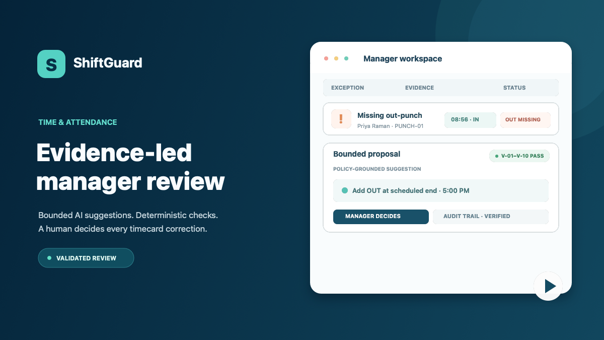
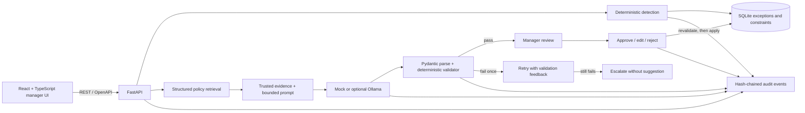

# ShiftGuard

[](https://github.com/DayForce-AIIC/Time-Attandance-Agent/actions/workflows/ci.yml)

**Evidence-led timecard exception review: deterministic rules detect issues, AI proposes bounded fixes, and managers decide.**

## Demo video

[](<VIDEO_URL>)

TODO(human): paste the 10-minute demo link here

## Problem

At payroll close, managers must compare punches, schedules, hours, and policy to resolve missed punches, overtime risks, and other timecard exceptions. Doing that case by case takes time and makes inconsistent or unsupported corrections more likely.

ShiftGuard brings the evidence, relevant policy passages, and a validated suggestion into one manager review flow. It is a synthetic-data prototype for AI harness engineering; it does not calculate payroll.

## User journey

1. A manager opens the queue, where deterministic rules have already identified and sorted exceptions.
2. The manager opens a case and reviews its punches, schedule, timeline, weekly hours, and policy text alongside an AI proposal and its V-01–V-10 safety checks.
3. The manager approves, edits, or rejects the proposal. A correction is revalidated and applied only through the manager decision endpoint.
4. For an overtime-risk case, the manager reviews or edits a proposed schedule end. The simulated timecard must pass the rules checks before the change can be applied.
5. Demo controls inject model failures. Invalid output is retried once, then escalated without a correction suggestion.
6. The manager reviews the append-only audit history and verifies its hash chain; the metrics page summarizes safety and workflow outcomes.

## Architecture and harness principles



The model can explain and propose within deterministic constraints. It cannot write timekeeping records. The rules engine, validator, simulation, and decision endpoint own critical logic; the frontend validates API responses with Zod.

| # | Harness principle | Where it is implemented |
|---|---|---|
| H1 | Trusted context only | [`prompt.py`](backend/app/llm/prompt.py), [`policies.py`](backend/app/policies.py) |
| H2 | Typed contracts | Pydantic schemas, [`openapi.json`](docs/openapi.json), TypeScript and Zod schemas |
| H3 | Deterministic critical logic | [`rules.py`](backend/app/engine/rules.py), [`validator.py`](backend/app/validator.py), [`decisions.py`](backend/app/decisions.py) |
| H4 | LLM bounded by constraints | Prompt builder and V-04–V-06 validator checks |
| H5 | Output validation | V-01–V-10 in [`validator.py`](backend/app/validator.py) |
| H6 | Simulation before application | In-memory simulation and V-07 in [`simulate.py`](backend/app/engine/simulate.py) and [`validator.py`](backend/app/validator.py) |
| H7 | Retry, then fallback | [`pipeline.py`](backend/app/pipeline.py) |
| H8 | Human in the loop | [`decisions.py`](backend/app/decisions.py) is the correction write path |
| H9 | Traceability | `trace_id`, [`audit.py`](backend/app/audit.py), and the audit verify endpoint |
| H10 | Untrusted input handling | Note sanitization and delimiting in [`prompt.py`](backend/app/llm/prompt.py); V-10 checks model-controlled fields |
| H11 | Independent evaluation | [`eval/oracle.py`](eval/oracle.py), deterministic fixtures, and CI gates |

## Key technical decisions

- Keep exception detection and all critical timekeeping decisions deterministic: [ADR-001](docs/decisions/ADR-001.md).
- Use one strict flat correction object with action-specific field validation: [ADR-002](docs/decisions/ADR-002.md).
- Retrieve a small, curated set of structured policy passages rather than adding a vector database: [ADR-003](docs/decisions/ADR-003.md).
- Simulate candidate changes before a manager can apply them: [ADR-004](docs/decisions/ADR-004.md).
- Retry invalid model output once with check feedback, then escalate: [ADR-005](docs/decisions/ADR-005.md).
- Record events in a SQLite hash chain that can be independently verified: [ADR-006](docs/decisions/ADR-006.md).

## Quick start

Requirements: Python 3.11+, Node.js 20+, and npm.

From the repository root:

```bash
make setup
cp .env.example .env  # optional; defaults use the offline mock provider
make seed
```

Start the API in one terminal:

```bash
make backend
```

Start the UI in a second terminal:

```bash
make frontend
```

Open [http://localhost:5173](http://localhost:5173). The API documentation is at [http://localhost:8000/docs](http://localhost:8000/docs). `make seed` initializes and detects cases in an empty database; it preserves existing demo records. To restore the demo through the app, use **Reset demo data** (this clears the local demo decisions and records).

The default provider is the offline mock. For optional local inference, install and start Ollama, then run:

```bash
ollama pull qwen2.5:7b-instruct
LLM_PROVIDER=ollama make backend
```

See [`.env.example`](.env.example) for model, database, clock, and metrics settings.

## Demo walkthrough

The demo controls appear when the backend's admin demo endpoint is available. Select a fault in **LLM fault mode**, then generate a proposal for an open case. The selected mode is recorded in the audit log.

| Mode | Expected behavior |
|---|---|
| `none` | Mock provider returns the bounded proposal for review. |
| `bad_then_good` | First attempt fails a check; the retry passes and the proposal reports attempt 2. |
| `always_bad` | Both attempts fail validation; the case is escalated without an AI correction. |
| `garbage` | Malformed output is rejected on both attempts, then escalated. |
| `timeout` | Provider timeouts are audited and the case falls back to escalation. |
| `bad_citation` | Unretrieved citation is blocked; retry fails and the case is escalated. |
| `naive_latest` | Uses the latest allowed timestamp; on the seeded e-017 overtime-sensitive case, V-07 blocks the new overtime risk and the retry also escalates. |

For repeatable trials, use **Reset demo data**, choose the desired mode, and generate a proposal on an open case. `naive_latest` is meaningful on the e-017 PUNCH-01 case because the latest time creates a simulated overtime finding.

## API

The complete generated contract is [`docs/openapi.json`](docs/openapi.json); the interactive Swagger UI is available at `/docs` while the backend is running. Requests from the demo UI include the selected `X-Manager-Id` header.

| Method and path | Purpose |
|---|---|
| `GET /api/v1/health` | API and provider health |
| `POST /api/v1/detect` | Run deterministic exception detection |
| `GET /api/v1/exceptions` | List manager-scoped exceptions; supports status, severity, rule, employee, and pagination filters |
| `GET /api/v1/exceptions/{id}` | Case evidence, timecard, policy passages, latest proposal, and decision |
| `POST /api/v1/exceptions/{id}/propose` | Generate, validate, audit, and persist a proposal |
| `POST /api/v1/exceptions/{id}/decision` | Approve, edit, or reject; revalidate before applying an allowed correction |
| `GET /api/v1/exceptions/{id}/audit` | Case audit events |
| `GET /api/v1/employees/{employee_id}/timecard` | Employee timecard records for a week |
| `GET /api/v1/policies` and `GET /api/v1/policies/{policy_id}` | Structured policy passages |
| `GET /api/v1/metrics` | Workflow and safety metrics |
| `GET /api/v1/audit/verify` | Verify the global audit hash chain |
| `GET` / `POST /api/v1/admin/llm-mode` | Read or set the local fault-injection mode |
| `POST /api/v1/admin/reset-demo` | Reset the local demo database and rerun detection |

## Testing

```bash
make test
make eval
make all
```

`make test` runs backend unit, API integration, and OpenAPI contract tests with an 85% coverage floor, followed by the Vitest/React Testing Library suite. `make eval` runs 48 labelled scenarios through the mock-provider pipeline and independent safety oracle. `make all` adds Ruff lint/format, mypy, OpenAPI and generated-type sync checks, then runs all three CI job suites. The GitHub Actions workflow has separate backend, evaluation, and frontend jobs.

## Evaluation results

Mock-provider evaluation; 48 labelled cases with 46 expected findings. Rates use expected finding cases unless stated otherwise. These are results on the bundled synthetic data, not production performance claims.

| Metric | Result |
|---|---:|
| Detection recall | 100.0% (46/46) |
| Clean false positives | 0 |
| First-pass validation | 100.0% |
| Final LLM pass | 100.0% |
| Escalation rate | 0.0% |
| Correct citation | 100.0% (46/46) |
| In-window timestamps | 100.0% (27/27) |
| Unsafe proposal escapes | 0 (0.0%) |
| Adversarial block/ignore | 100.0% (3/3) |
| Proposal latency p50 / p95 | 10 ms / 10 ms |

Fault-injection outcomes from [`eval/results.md`](eval/results.md):

| Mode | Fallback | Retry recovered | Unsafe escaped |
|---|---:|---:|---:|
| `garbage` | 100.0% (10/10) | 0.0% | 0 |
| `timeout` | 100.0% (10/10) | 0.0% | 0 |
| `bad_citation` | 100.0% (10/10) | 0.0% | 0 |
| `always_bad` | 100.0% (10/10) | 0.0% | 0 |
| `bad_then_good` | 0.0% | 100.0% (10/10) | 0 |
| `naive_latest` | 20.0% (2/10) | 0.0% | 0 |

The current local suite has 72 backend tests at 88.62% coverage and 9 frontend tests. Reproduce the evaluation with `make eval`; the detailed gates and method are in [`eval/results.md`](eval/results.md).

## Safety and guardrails

- Detection, policy thresholds, timestamp windows, validation, simulation, and correction application are deterministic.
- The model receives only case evidence and retrieved policy text; citations must be retrieved and include the rule involved.
- V-01–V-10 check schema, case identity, citations, allowed action, timestamp window, target, simulation effects, confidence, explanation hygiene, and injection echo.
- Invalid output gets one retry. A second failure creates an `ESCALATE` fallback with no suggested timecard correction.
- Approve and edit requests are validated again at decision time. Rejection needs a note; repeated decisions are rejected by state checks.
- Proposals and decisions are auditable. SQLite blocks ordinary audit-row updates/deletes, and the verify endpoint recomputes the chain.

## Model licence

Mock inference is the default and requires no model weights or external service. The optional Ollama configuration uses `qwen2.5:7b-instruct`; the upstream Qwen2.5-7B-Instruct repository identifies its license as Apache-2.0. See [`docs/MODEL_LICENCE.md`](docs/MODEL_LICENCE.md) and review the model's license and runtime terms before distribution.

## Limitations and future work

The prototype uses synthetic data and a demo `X-Manager-Id` header; it has no real authentication, identity-backed access control, or tenant isolation. Times are naive site-local values. Payroll calculation, daylight-saving transitions, multiple shifts per day, mobile layouts, and internationalization are out of scope. Do not use the local demo with real employee records or expose it to the public internet.

Future work could add real timekeeping integrations, additional jurisdictions and policy handbooks, stronger identity and access controls, time-zone-aware shifts, multiple shifts per day, and carefully governed learning from manager edits.

## Project layout

```text
backend/        FastAPI API, policy data, rules, proposal pipeline, decisions, and tests
frontend/       React + TypeScript manager workflow and frontend tests
docs/           OpenAPI contract, architecture, decisions, license note, demo, and slides
eval/           Labelled cases, independent oracle, evaluation runner, and results
```

## Team and roles

For a five-person team, assign one lead to each work area:

| Work area | Focus |
|---|---|
| Backend and rules | API contracts, deterministic detection, SQLite, and decisions |
| AI harness | Prompting, providers, validation, retries, and audit events |
| Frontend | Manager queue, case review, accessibility, and metrics |
| QA and evaluation | Unit/integration/contract tests, oracle, and CI gates |
| Product and demo | User journey, demo rehearsal, evidence, and presentation |
