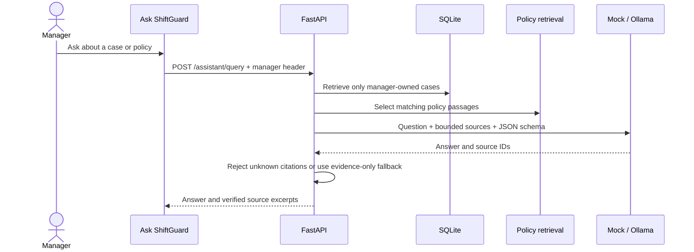

# ShiftGuard architecture

## Components and data flow

| Component | Responsibility |
|---|---|
| React + TypeScript frontend | Manager queue, case evidence, proposal checks, decisions, metrics, demo controls, and audit drawer. TanStack Query handles API state; Zod validates responses. |
| FastAPI API | Exposes `/api/v1` routes, applies demo manager scoping, maps domain errors, and carries request trace IDs. The demo manager header is not production authentication. |
| Rules engine | Pure deterministic checks over punches, schedules, policy thresholds, and the business clock. Produces exceptions and allowed-action/time-window constraints. |
| SQLite repository | Stores synthetic managers/employees, punches, schedules, exceptions, proposals, decisions, adjustments, and audit events. SQL is isolated in `backend/app/repo.py`. |
| Policy retrieval and prompt builder | Selects the violated rule and up to two related passages from `backend/app/policies.json`; includes only the case facts and retrieved policy context. Employee notes are sanitized and delimited as untrusted data. |
| Proposal client and fault injector | Uses the deterministic offline mock by default, with an optional Ollama client. Demo modes mutate or fail model output reproducibly. |
| Read-only assistant | Retrieves up to five cases owned by the selected manager and up to five matching policy passages; asks the configured model to summarize only that evidence and validates returned source IDs. It stores no chat transcript. |
| Validator and simulation | Parses strict contracts, performs checks V-01–V-10, copies records in memory, applies a candidate, and reruns detection before any manager decision. |
| Decision service | Checks case ownership and state, validates an approval/edit again, and records the decision plus any correction in a database transaction. Reject writes no timekeeping correction. |
| Audit and metrics | Records traceable events in a global hash chain and computes workflow/safety measures from stored records. |
| Evaluation harness | Runs 48 labelled synthetic cases through the actual detection/proposal pipeline and checks outcomes with an independent oracle. |

The key invariant is that the proposal endpoint does not change punches or schedules. Only a valid `approve` or `edit` decision can apply a correction, and both are revalidated against current data.

`POST /api/v1/assistant/query` is an independent read-only path. It does not call proposal or decision services, does not include employee notes, and does not write case, timecard, or audit rows. The response contains the source excerpts and IDs; an unavailable model or unknown citation produces a deterministic evidence-only answer. Citations are checked, while the semantic accuracy of generated prose is not mechanically proven.



## Proposal, retry, fallback, and decision sequence

```mermaid
sequenceDiagram
  actor Manager
  participant UI as React manager UI
  participant API as FastAPI
  participant DB as SQLite
  participant Policy as Policy retrieval
  participant LLM as Mock / Ollama + fault injector
  participant Validator as Deterministic validator
  participant Audit as Audit chain

  Manager->>UI: Open case and Generate AI proposal
  UI->>API: POST /exceptions/{id}/propose
  API->>DB: Load exception, employee, punches, schedules
  API->>Policy: Retrieve violated and related passages
  Policy-->>API: Trusted policy passages
  loop At most two attempts
    API->>Audit: PROMPT_BUILT (prompt hash and prompt text)
    API->>LLM: Generate from bounded context
    LLM-->>API: JSON output or provider error
    API->>Audit: LLM_CALL / LLM_ERROR
    API->>Validator: Parse, check constraints, simulate, rerun rules
    Validator-->>API: Proposal and V-01–V-10 result
    API->>Audit: Schema and validation results
    alt Valid proposal
      API->>DB: Save proposal, set PENDING_REVIEW
      API->>Audit: PROPOSAL_CREATED
    else First attempt failed
      API->>Audit: RETRY with failed-check feedback
    else Second attempt failed
      API->>DB: Save ESCALATE fallback, set ESCALATED
      API->>Audit: FALLBACK and PROPOSAL_CREATED
    end
  end
  API-->>UI: Persisted proposal or escalation
  Manager->>UI: Approve, edit, or reject
  UI->>API: POST /exceptions/{id}/decision
  API->>Validator: Revalidate approve/edit against current state
  alt Valid approve/edit
    API->>DB: Transaction: decision + correction + adjustment
    API->>Audit: DECISION_MADE and CORRECTION_APPLIED
  else Reject or invalid edit
    API->>DB: Record reject, or leave timekeeping unchanged
    API->>Audit: Record decision or validation failure
  end
  API-->>UI: Decision result; refresh case and queue
```

## Audit hash chain

Each event stores canonical JSON (`sort_keys=True`, compact separators), a per-trace sequence number, a previous-event hash, a UTC creation time, and a SHA-256 digest. The digest covers `prev_hash`, `trace_id`, `exception_id`, `seq`, `event_type`, canonical payload JSON, and `created_at`. The previous hash links the next event across the complete SQLite log; sequence numbers are scoped to a trace.

SQLite triggers reject ordinary `UPDATE` and `DELETE` operations on `audit_log`. `GET /api/v1/audit/verify` walks events in database order, recomputes each digest, and returns the first invalid event. This makes normal tampering detectable; it is not an external cryptographic anchor, so an actor able to rewrite the database and recompute the entire chain is outside the prototype's protection.

## Threat model

| Threat | Mitigation | Regression test |
|---|---|---|
| Model invents or cites an unavailable policy | Retrieval supplies the breached rule and related passages; V-03 requires every citation to be retrieved and requires the breached rule. V-09 blocks unknown or uncited rule IDs in the explanation. | `test_v03_citations_must_be_retrieved_and_include_rule`; `test_v09_unknown_uncited_rule_token_and_url_fail` |
| Assistant crosses manager scope or invents a source | Retrieval filters by the active manager; question/answer content cannot access write services; source IDs are checked against the returned source set, with an evidence-only fallback. | `test_assistant_does_not_return_another_managers_employee`; `test_assistant_uses_evidence_only_answer_when_model_citation_is_unknown` |
| Assistant implies an unsupported absence prediction or attendance status | Individual absence forecasting and WFH/leave reconciliation are explicitly declined until their required data exists. | `test_assistant_declines_absence_prediction_and_unmodeled_leave_statuses` |
| Proposal timestamp falls outside the safe window | Prompt states the bounds; V-05 checks the inclusive window and punch kind; V-07 simulates the change before review. | `test_v05_timestamp_and_add_kind_must_match`; `test_v07_e017_out_at_1945_creates_ot01_but_1830_is_safe` |
| Employee note contains prompt injection | Note text is sanitized, placed inside an untrusted delimiter, and never used as policy. V-10 inspects model-controlled output for injection echo; the note itself is not treated as model output. | `test_sanitize_note_removes_controls_and_caps_text`; `test_v10_model_output_injection_echo_fails`; `test_employee_note_injection_is_not_scanned` |
| Punch edit is used to hide or create overtime risk | Allowed actions/targets are case-specific. V-07 applies the candidate to copies and reruns the deterministic rules, rejecting new high-severity findings; schedule edits also have a minimum planned-work threshold. | `test_v07_e017_out_at_1945_creates_ot01_but_1830_is_safe`; `test_v07_ot02_rejects_adjustment_that_leaves_overtime` |
| Decision is replayed or applied twice | Decision service requires an eligible state and latest proposal, checks manager ownership, and records correction plus decision transactionally. A subsequent decision returns a conflict. | `test_owner_double_decision_and_escalation_guards` |
| Audit event is changed or removed | SQLite triggers block normal row updates/deletes; chain verification recomputes links and hashes and reports the first bad event. | `test_audit_events_verify_and_detect_tampering` |

## Boundaries

The prototype uses seeded synthetic data, a local SQLite file, a demo manager header, naive site-local time strings, and a hand-authored policy set. There is no production identity system, tenant isolation, external timekeeping integration, payroll calculation, timezone/DST support, or external audit anchor.
